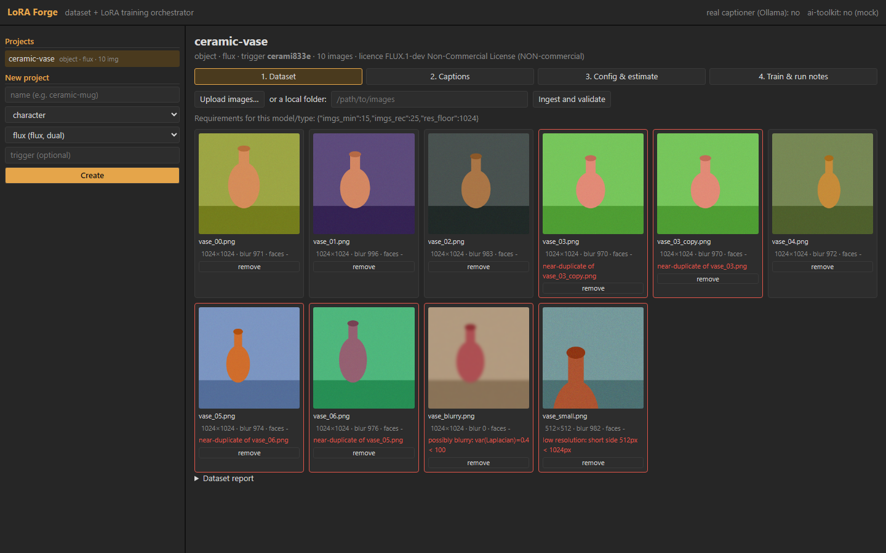
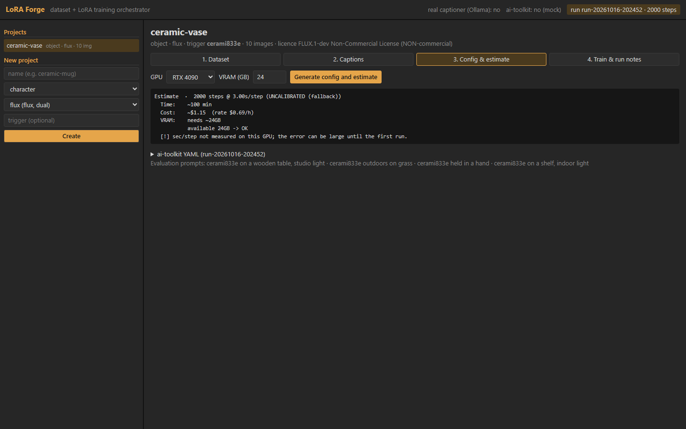

# lora-forge

**Most failed LoRAs are weak datasets, not bad trainers.** LoRA Forge is the layer that sits in front of the trainer: guided dataset intake, validation that blocks until a human has looked at the flags, auto-captioning that follows the right doctrine for each LoRA type and base model, and a VRAM/time/cost estimate before a GPU is rented. It does not train anything itself: it generates the config for [ostris/ai-toolkit](https://github.com/ostris/ai-toolkit) and launches it.



## Why

What you **describe** in a caption becomes promptable (a variable); what you **leave out** is absorbed into the trigger token. So a character LoRA should caption clothing, pose, light and framing, but never the face; a style LoRA should caption only the content, never the style; an object LoRA should caption context and angle, but not the object's own defining features. LoRA Forge applies that rule automatically per type (character / style / object) and per base model (tags, natural language or both), and refuses to move on silently when the dataset has problems.

## What it does

| Step | Command | What happens |
|---|---|---|
| New project | `forge new teapot --type object --model flux` | prints a requirements card for that type × model (image count, resolution floor, advice, licence) and proposes a rare trigger token |
| Ingest | `forge ingest ./raw_images` | checks resolution, sharpness (variance of the Laplacian), near-duplicates (perceptual dHash) and aspect ratio; writes `manifest.json` and a Markdown report; **blocks** if anything is flagged |
| Caption | `forge caption [--real]` | writes one `.txt` per image following the doctrine; idempotent, never overwrites a manual edit without `--force`. `--real` uses a local vision model served by Ollama |
| Config | `forge config --gpu "RTX 4090" --gpu-vram 24` | generates the ai-toolkit YAML from the model registry and estimates VRAM, minutes and dollars **before** launching |
| Train | `forge train <run_id> [--mock]` | launches the backend detached, tails the log and measures the real sec/step, which replaces the rough estimate next time |
| Report | `forge report <run_id>` | a run note in Markdown with YAML frontmatter: hashes, dataset stats, licence warning, findings |
| Pick | `forge pick <run_id> <checkpoint>` | records your chosen checkpoint (the calibration set for a future automatic evaluator) |

Utilities: `forge models`, `forge env`, `forge status`.

Every run pins **manifest hash + caption hash + config hash**. Captions are edited by hand, so they are part of what makes a run reproducible.



## Quickstart

Local, no GPU (mock captioner and mock training exercise the whole pipeline):

```bash
pip install -e ".[web,dev]"
python -m pytest

# CLI
forge new teapot --type object --model flux
cd teapot
forge ingest ../my_images
forge caption
forge config --gpu "RTX 4090" --gpu-vram 24
forge train <run_id> --mock

# Web app (React + FastAPI) on http://127.0.0.1:8800
cd forge_web/frontend && npm ci && npm run build && cd ../..
python examples/make_demo_project.py ./demo/projects       # synthetic demo project
FORGE_PROJECTS=./demo/projects python forge_web/api.py
```

On Windows, `start_lora_forge.bat` creates the environment, builds the frontend and opens the browser.

Real captions: run [Ollama](https://ollama.com) with a vision model (`FORGE_CAPTION_MODEL`, default `minicpm-v4.5:8b`) and press "Generate with a vision model", or use `forge caption --real`.

Real training happens on a rented GPU box. `setup_pod.sh` is idempotent and reads every credential from the environment (`HF_TOKEN` for gated base models, optional `AWS_*` for an S3-compatible bucket). The web app always listens on 127.0.0.1: reach it from your machine through an SSH tunnel.

## Architecture

Core-as-a-library: the CLI and the web app are thin frontends over the same functions, so the web app cannot drift from the logic and everything it does can be scripted.

```
forge_core/      all the logic, pure Python, no UI
  models.json    data-driven registry: arch, checkpoint, presets, VRAM, requirements, licence, measured sec/step
  validate.py    resolution, Laplacian sharpness, dHash duplicates, optional face count (opencv)
  captionrules   what to describe and what to omit, per LoRA type
  caption/       mock captioner + Ollama vision captioner
  config_gen     ai-toolkit YAML from the registry presets
  estimate       VRAM / time / cost, calibrated by real measurements
  runstate       SQLite (WAL): runs, checkpoints, picks, measurements
  report         Markdown run notes with frontmatter
forge_cli/       Typer CLI
forge_web/       FastAPI (api.py) + React/Vite frontend
```

State lives in SQLite (`forge.db`); metadata (descriptor, manifest, captions, configs, run notes, calibration) is plain text meant for git. Weights never go into the repo.

**Local-only server.** `api.py` binds to 127.0.0.1, rejects any request whose `Host` is not local (DNS rebinding) or whose `Origin` is foreign or `null`, and resolves every file name from a URL inside its folder with a `commonpath` check. There is no CORS.

## Tests

```bash
python -m pytest
```

11 tests, all with images generated in code (noise, gradients, flat colours: no photos, no people): validation flags, registry coherence, config generation, the full CLI flow in mock mode, the full web flow in mock mode, and the server guards (foreign Origin, `null` Origin, foreign Host, path traversal).

## Status and roadmap

Honest state of things:

- **Done and tested:** core library, CLI, web app, mock flow end to end, Ollama captioner (tried on real images: it describes clothing, pose and light and leaves the face out), ai-toolkit config generation, estimates, run notes, calibration export.
- **Written but not exercised here:** real training on a GPU box through `setup_pod.sh` (it needs a paid GPU, so the tests use the mock backend). The ai-toolkit YAML keys should be checked against the installed version; the YAML header says so.
- **Only FLUX.1 dev is marked active.** SDXL, Z-Image and Qwen-Image are in the registry as `unverified` until their paths and licences are checked at the source.
- **Roadmap:**
  - Phase 2: GPU captioners (WD14 tags, JoyCaption) next to the Ollama one.
  - Phase 3: an evaluator that renders the fixed eval prompts for every checkpoint and a strength grid in ComfyUI.
  - Phase 4: identity checks for character LoRAs (ArcFace) and close-up ratio from face boxes; automatic checkpoint picking once its agreement with human picks passes the calibration gate (10 picks, 80 % rolling agreement).
  - Video LoRAs through a second backend.

## Lessons learnt

- Perceptual hashes are blind to colour: two synthetic images with the same composition and different palettes come out as near-duplicates (you can see it in the screenshot). For real photos that is usually what you want; for flat graphics it is a false positive the human review catches.
- The licence of the base model travels with the LoRA. FLUX.1 dev is non-commercial, so every run note says so at the top.
- An estimate is only useful once it is calibrated. The first run on each GPU measures sec/step and stores it, and the next estimate uses that number instead of the fallback.

## About

Made by The Jungle Fruit, a motion and creative technologist, as the dataset side of a larger image and video pipeline.

Licence: AGPL-3.0-or-later (see `LICENSE`): free to use, study, change and share. If you run a modified version
as a network service, you must offer its users the source code of that version.

**Commercial licence.** If you want to use it in a closed product or service without the AGPL obligations, a
commercial licence is available: thejunglefruit@proton.me
